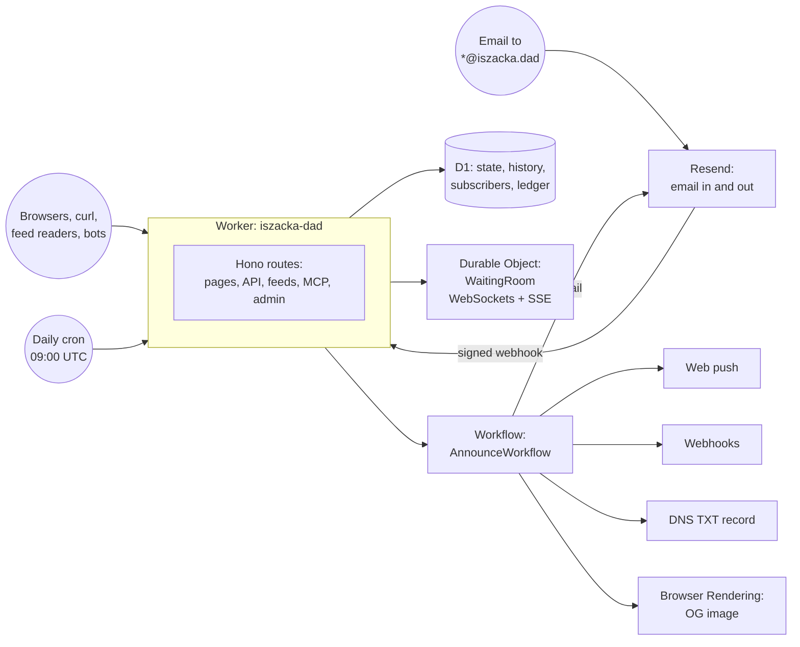

# Is Zack a dad?

[](https://github.com/zackpollard/iszacka.dad/actions/workflows/ci.yml)
[](https://github.com/zackpollard/iszacka.dad/actions/workflows/deploy.yml)
[](https://iszacka.dad)

**[iszacka.dad](https://iszacka.dad)** answers exactly one question: is Zack a dad yet?

The answer is **NO**. Then, briefly, **NOT YET** (it's happening). Then **YES**. That's three
states and one bit of genuinely interesting information, so naturally it runs on a Cloudflare
Worker with a database, a Durable Object, a durable Workflow, a headless browser, a
cryptographically signed hash chain, an MCP server and a DNS record. A static page with the
word "no" on it would have been fine. It would also have been much less fun.

```console
$ curl iszacka.dad
$ dig +short TXT answer.iszacka.dad
$ curl -i https://iszacka.dad/api/dad        # HTTP/1.1 425 Too Early
```

## Features

**The answer**

- A giant **NO** / **NOT YET** / **YES** that updates live over WebSockets, no refresh needed
- Live viewer count, a good-vibes button, and counters for how many times anyone has checked
- A countdown to the due date, then "overdue by…", then "dad for…"
- Confetti on the flip
- "No" in 40+ languages, plus an answer in whatever your `Accept-Language` says
- A browser text-to-speech **Listen** button, for reading "no" aloud
- A favicon and page title for each state
- The baby's size, as fruit
- A 7-day dad forecast
- Dark mode, and screen-reader announcements when the answer changes

**Finding out the moment it happens**

- Email updates with double opt-in and one-click unsubscribe: "only when it happens", or a
  "daily NO" for completists (sent with [Resend](https://resend.com), within its free plan)
- Web push, and an installable PWA with an offline page
- RSS, Atom and JSON Feed; an iCal feed; webhooks for Discord, Slack or anything else (signed)
- Email any address `@iszacka.dad` and get an auto-reply (try `ask@iszacka.dad`)
- A DNS TXT record with the answer in it
- ASCII art for `curl`, and a server-sent events stream

**For machines**

- A JSON and plain-text API, with an OpenAPI document and docs; `/api/dad` returns
  `425 Too Early`, and one day `201 Created`
- An MCP server, so your AI assistant can ask too (the site itself never calls an AI)
- A status badge and an embeddable widget
- `llms.txt`, `humans.txt`, `security.txt`, `robots.txt` and a sitemap
- `X-Is-Zack-A-Dad` and `Server-Timing` (gestation so far, in milliseconds) headers on every
  response

**Gratuitous rigour**

- The Dad Ledger: a hash-chained, Ed25519-signed, publicly verifiable record of every change
- A baby pool (guess the time; you can enter by email too)
- A status page parody, and anxiety analytics
- A dad readiness checklist, a congratulations wall (moderated) and a name suggestion box
  (moderated)
- A printable Certificate of Dadhood, and a printable fridge poster with a QR code
- Easter eggs, and a greeting for wherever you're checking from
- Live Open Graph images, rendered with Browser Rendering
- A durable notification Workflow with a 60-second undo window and a delivery log
- An admin panel with the big red button
- Turnstile and rate limits on every form; CSP and HSTS everywhere
- Unit tests, end-to-end smoke tests, and a preview deploy for every pull request

## How it works

One Worker does everything. [docs/ARCHITECTURE.md](docs/ARCHITECTURE.md) is the full contract:
the hard rules, module ownership, the URL map, the live protocol and the UI kit.



- **Status model.** `no` → `soon` (labour has started) → `yes`. The admin flips it. That writes
  the history and the Dad Ledger, broadcasts to every open tab, and starts `AnnounceWorkflow`.
- **Notifications** wait out a 60-second undo window, then go out in batches (email, push,
  webhooks), each a retried, durable step that skips anyone it already reached, then update the
  DNS record and the OG image. If the day's email quota runs out mid-announcement, the Workflow
  sleeps until it resets at midnight UTC and carries on.
- **Inbound email** arrives at Resend, which posts a signed webhook to `/api/resend/webhook`; the
  Worker checks the signature, ignores repeats, and auto-replies with the answer (or enters a baby
  pool guess).
- **Live updates** come from a single `WaitingRoom` Durable Object holding every WebSocket and
  SSE client.
- **Abuse protection**: rate limits on everything public, Turnstile on forms, and HTML that is
  escaped by construction (`hono/html`) behind a CSP that blocks inline scripts.
- **Privacy**: the site knows the status, when it changed, and the due date. That's it. No names,
  weights, photos or places, and IP addresses are only ever stored as salted hashes.

```
src/
  index.ts           entry: middleware, headers, route mounting, cron handler
  routes/            one Hono router per feature area
  lib/               state, security, layout, feeds, ledger, pool, ...
  do/                the WaitingRoom Durable Object
  workflows/         AnnounceWorkflow
  notify/            email, push, webhooks, DNS
public/              static assets (CSS, client JS, service worker, icons)
migrations/          D1 schema
scripts/             smoke.sh, setup-cloudflare.sh
test/                vitest unit tests
.github/             CI, deploys and PR previews
```

## Local development

You need Node 24.

```bash
npm ci
cp .dev.vars.example .dev.vars        # admin password: dev
npm run db:migrate:local
npm run dev                           # http://localhost:8787
```

Then open <http://localhost:8787>, or <http://localhost:8787/admin> to press the button.

Checks:

```bash
npx tsc --noEmit                      # typecheck
npx vitest run                        # unit tests
bash scripts/smoke.sh http://localhost:8787 --mutate   # end-to-end, button and all
```

`smoke.sh` walks every URL in the architecture doc and checks status codes, content types,
headers, feeds, MCP, the WebSocket and the SSE stream. `--mutate` also logs in to the admin panel,
flips the answer to NOT YET, checks everything noticed, and flips it back. It refuses to do that to
anything that looks like production. It needs `curl`, `jq` and Node.

> **Why does the Worker think it's on iszacka.dad?** Because `wrangler.toml` has routes, plain
> `wrangler dev` tells the Worker that every request arrived at the first route. Start it with
> `npx wrangler dev --infer-origin-from-routes=false` to keep the real `localhost` origin
> (CI does), which the admin panel's same-origin checks prefer.

Running several dev servers at once (for example, one per agent)? Give each its own port and
state directory:

```bash
npx wrangler d1 migrations apply iszackadad --local --persist-to .wrangler/mine
npx wrangler dev --port 8790 --persist-to .wrangler/mine
```

## Deploying

There is no deploy button. There is a merge button.

- **Every pull request** gets typechecked, unit-tested and smoke-tested against `wrangler dev`
  ([`ci.yml`](.github/workflows/ci.yml)), and deployed to its own preview Worker at
  `iszacka-dad-pr<N>.<account>.workers.dev` ([`preview.yml`](.github/workflows/preview.yml)).
  A comment on the PR has the link. Preview `/admin` uses the `PREVIEW_ADMIN_PASSWORD` repository
  secret (and is off without it); previews are public, so that password is never published.
  Closing the PR deletes it.
- **Every push to `main`** ([`deploy.yml`](.github/workflows/deploy.yml)) runs the checks,
  finds or creates the `iszackadad` D1 database, applies migrations, runs `wrangler deploy`, syncs
  the Worker secrets from GitHub secrets, and smoke-tests production.
- **Once, by hand** ([`setup.yml`](.github/workflows/setup.yml)): the Setup workflow hooks up
  Resend (domain, DNS records, webhook) and Turnstile, and stores their secrets on the Worker.

D1 database ids are never committed: `wrangler.toml` holds `PLACEHOLDER_D1_ID` and
`PLACEHOLDER_D1_PREVIEW_ID`, and CI swaps in the real ids by database name.

## Setting it up from scratch

[docs/SETUP.md](docs/SETUP.md) has the whole thing, step by step: the zone, the API token (with
the exact permissions) and a Resend key, GitHub secrets, the first deploy, the Setup workflow
(`scripts/setup-cloudflare.sh`: Resend's domain, DNS records and webhook, Turnstile and DMARC),
and checking it all works with the smoke test.

## House rules

- No AI calls anywhere. The MCP server is for other people's assistants.
- No personal data. The site knows the status, when it changed, and the due date. The repo is
  public: no secrets, no real email addresses, nothing about the baby.
- No gendered pronouns for anyone: Zack, Jess, the baby.
- Everything is escaped, and no inline scripts.
- British English. It's a nappy, not a diaper.

Contributor and agent conventions are in [CLAUDE.md](CLAUDE.md).
